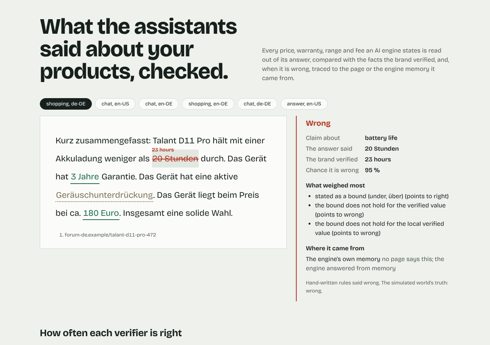
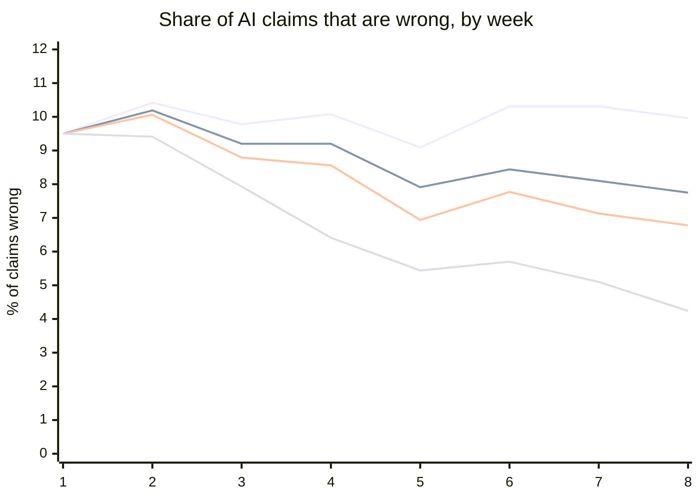
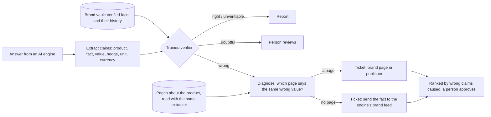

# brand-accuracy-loop

**Checks what AI assistants say about a brand against the brand's verified facts, finds the page or the engine
memory behind every wrong claim, and plans the week's corrections.**

When someone asks an assistant what a product costs, how long its battery lasts or what a card charges abroad, the
answer is often stale or wrong: an old review, a forum guess, a model that learned last year's price. A visibility
dashboard shows that the brand was mentioned. A brand team needs three more things: which claims are wrong (without
crying wolf), where each one came from, and which fixes to send first so the next week's answers get better.
This repository does those three steps (detect, diagnose, correct) and measures each against a world whose truth
it never reads.



## Results

Dev world: 1,280 answers from 4 engines to 320
prompts, holding 4,336 claims, 30 % of them in German. Every
number below is written by `scripts/evaluate.py` into `reports/dev.json` and copied here by `scripts/readme.py`; CI
regenerates both and fails on any difference.

| | Hand-written rules | Trained verifier |
|---|--:|--:|
| False alarms per 1,000 claims | 19.1 | **0** |
| Wrong claims caught | 100.0% | 99.51% |
| Error on German answers | 0.85% | 0.08% |

| | Blame the first citation | Value-matched diagnosis |
|---|--:|--:|
| Cause of a wrong claim found | 14.81% | **80.58%** |
| Publisher blamed for a page that was right | 75.0% | **0.0%** |
| Wrong claims after 8 weeks, 30 tickets a week | 7.75% | **4.24%** (from 9.5%) |

### Detect: is the claim right?

The guideline the annotators follow: exact numbers count as right within 3 % after unit conversion, hedged
numbers ("about", "rund", "up to") within 10 %, "under X" if the verified value is below X, money against the
market of its currency, and a fact the brand has not verified is *unverifiable*, never wrong.

| Design | Claims judged right | Wrong claims caught | Flags that were right | False alarms per 1,000 claims | Error, English | Error, German | Sent to a person |
|---|--:|--:|--:|--:|--:|--:|--:|
| String match (what simple monitors do) | 74.08% | 91.02% | 25.65% | 251 | 26.61% | 24.3% | 0.0% |
| Hand-written rules | 98.09% | 100.0% | 83.23% | 19.1 | 2.36% | 0.85% | 0.0% |
| Trained verifier | 99.95% | 99.51% | 100.0% | 0 | 0.03% | 0.08% | 0.0% |
| Trained verifier, doubtful claims to a person | 100.0% | 100.0% | 100.0% | 0 | 0.0% | 0.0% | 0.92% |

The rules use a fixed 2 % tolerance and the market the prompt was asked from; a careful engineer's first version.
They catch 100.0% of wrong claims and raise 19.1 false
alarms per 1,000 claims: 73 on hedged numbers, 10 on prices in another market's currency. The trained verifier learns the guideline from
labelled examples and is served as 32
weights and an intercept (`models/verifier.json`): no training library at run time, under a millisecond per answer
on one core. Every verdict lists the verified value and the three features that weighed most. The review design
sends the 0.92% of claims with a probability between 0.2 and 0.8 to a person, at
€35.16 per 1,000 answers (1.5 minutes a claim, €45 an hour).

An LLM judge on every claim would read 194 input tokens per claim, about
$5.023 per 1,000 answers at $3 / $15 per million tokens. That is an estimate from the
prompt in `src/accuracy/judge.py`; its accuracy is not measured here (no model is called).

### Training the verifier

2,000 claims labelled by annotators who are wrong 5.5 % of the time (111 wrong labels), 169 of the usable ones German.
Five-fold cross-validation flags labels the model finds implausible and a second reader looks at them:
52 flagged, 52 of them really wrong. German examples are then weighted up to
the English ones, because the answers are 30 % German and the labels
are not. The four ways of training, measured on the dev answers:

| Training data | Claims judged right | Wrong claims caught | False alarms per 1,000 | Error, English | Error, German |
|---|--:|--:|--:|--:|--:|
| As annotated | 99.79% | 97.82% | 0 | 0.23% | 0.16% |
| Doubtful labels read again | 99.84% | 98.3% | 0 | 0.16% | 0.16% |
| German weighted up | 99.79% | 98.3% | 0.5 | 0.23% | 0.16% |
| Both (used) | 99.95% | 99.51% | 0 | 0.03% | 0.08% |

### Diagnose: which page caused it?

A page is a suspect only if it says the same wrong value as the answer and disagrees with the vault; a cited suspect
outranks an uncited one. If no page says it, the engine answered from memory and the ticket goes to the engine's
brand feed instead of a publisher. Measured on the 412 wrong claims of week 1:

| Method | Cause found | Blamed a page that was right | Engine memory blamed on a page |
|---|--:|--:|--:|
| Blame the first citation | 14.81% | 75.0% | 94.19% |
| Blame the cited page closest to the answer | 25.24% | 60.19% | 94.19% |
| Find the page that says the same wrong value | 80.58% | 0.0% | 36.77% |

The remaining misses are mostly engine memory that happens to match an old review: both say last year's price,
and the review gets the ticket. Fixing that review is still useful; it is counted as a miss.

### Correct: 8 weeks, 30 tickets a week

Each week the trained verifier reads every answer, the diagnosis groups wrong claims by cause, and the
30 causes behind the most wrong claims get a ticket: update a brand page, write to a publisher (they fix it
about half the time), or send the verified fact to an engine's brand feed. Every design meets the same answers,
the same engine luck and the same publisher replies; only the tickets differ.



Lines, top to bottom at week 8: 1. No corrections, 2. Blame the first citation, 3. Blame the cited page closest to the answer, 4. Find the page that says the same wrong value.

| Diagnosis behind the tickets | Wrong claims, week 1 | Wrong claims, last week | Tickets sent | Fixes that landed |
|---|--:|--:|--:|--:|
| No corrections | 9.5% | 9.96% | 0 | 0 |
| Blame the first citation | 9.5% | 7.75% | 210 | 124 |
| Blame the cited page closest to the answer | 9.5% | 6.78% | 210 | 125 |
| Find the page that says the same wrong value | 9.5% | 4.24% | 210 | 102 |

Tickets built on the first citation reach publishers whose pages were right, so many "fixes" change nothing. After
8 weeks the share of wrong claims is 4.24% with value-matched diagnosis, 7.75% with the first
citation and 9.96% with no corrections.

## Held-out world (run once)

A second world with other brands, a fifth engine that cites less and reads more forums, 40 % German prompts,
and phrasings the extractor was never written for. It ran once, with the verifier trained on the dev world and no
change after (`config/heldout.lock`). 1,600 answers, 5,285 claims;
the extractor found 97.09% of them.

| Design | Claims judged right | Wrong claims caught | Flags that were right | False alarms per 1,000 claims | Error, English | Error, German | Sent to a person |
|---|--:|--:|--:|--:|--:|--:|--:|
| String match (what simple monitors do) | 70.97% | 89.57% | 28.13% | 253 | 30.76% | 26.45% | 0.0% |
| Hand-written rules | 94.4% | 96.58% | 79.92% | 26.9 | 4.68% | 6.96% | 0.0% |
| Trained verifier | 95.44% | 96.58% | 86.66% | 16.5 | 3.64% | 5.93% | 0.0% |
| Trained verifier, doubtful claims to a person | 95.52% | 96.58% | 87.19% | 15.7 | 3.54% | 5.88% | 0.44% |

| Method | Cause found | Blamed a page that was right | Engine memory blamed on a page |
|---|--:|--:|--:|
| Blame the first citation | 13.81% | 76.11% | 95.63% |
| Blame the cited page closest to the answer | 21.42% | 67.08% | 95.63% |
| Find the page that says the same wrong value | 78.76% | 0.0% | 39.81% |

| Diagnosis behind the tickets | Wrong claims, week 1 | Wrong claims, last week | Tickets sent | Fixes that landed |
|---|--:|--:|--:|--:|
| No corrections | 11.07% | 11.13% | 0 | 0 |
| Blame the first citation | 11.07% | 7.68% | 210 | 116 |
| Blame the cited page closest to the answer | 11.07% | 7.25% | 210 | 129 |
| Find the page that says the same wrong value | 11.07% | 4.94% | 210 | 86 |

With the same 30 tickets a week, value-matched diagnosis took the share of wrong claims from
11.07% to 4.94%; blaming the first
citation ended at 7.68%. The trained verifier caught
96.58% of wrong claims with 16.5 false
alarms per 1,000 claims (rules: 26.9). Value-matched diagnosis blamed a
correct page 0.0% of the time.

What the held-out run found: most of the trained verifier's false alarms there came from the extractor, not the
verifier. German prices written with a thin space as the thousands separator ("1 999 €", as DIN 5008 allows)
were read as 999 €, and the verifier rightly called 999 € wrong. Most missed claims were card percentages phrased
without a cue word ("gives 2% on every purchase"). The number format is fixed since, with a test; the cue words are
not. The held-out numbers above are as they first came out.

## How it works



- `src/accuracy/extract.py`: products by name, short name or pronoun; values with units, hedges, bounds and
  currencies in English and German ("1.299 €", "a 2-year warranty", "60 miles").
- `src/accuracy/verify.py`: string match, rules, the trained verifier and its review band.
- `src/accuracy/train.py`: cross-validated label cleaning, optional language weighting, exported weights.
- `src/accuracy/attribute.py`: the source index and the three diagnosis methods.
- `src/accuracy/corrections.py`: tickets with drafted outreach, ranked by damage.
- `src/accuracy/service/`: FastAPI: `POST /v1/answers/verify`, `GET /v1/tickets`, `PUT /v1/vault/facts`.
- `src/accuracy/world/`: brands, pages, five engine profiles and the truth. Only the evaluation and the tests read it.
- `infra/terraform/`: AWS (ECS Fargate behind a load balancer, ECR, CloudWatch alarms); validated in CI, not applied.
- `web/`: the console (React, Framer Motion) reading `web/public/data/console.json`.

## Run it

```bash
pip install -e '.[dev]'
python -m pytest -q                       # 30 tests, about 4 s
python3 scripts/evaluate.py               # dev world, about 45 s; trains the verifier, writes reports/dev.json
python3 scripts/readme.py                 # this README and the console data
uvicorn accuracy.service.main:app         # the API with the example vault
cd web && npm ci && npm run dev           # the console
```

## Limits

- The world is simulated. Its engines, pages and annotators follow rules written in `src/accuracy/world/`; real
  engines fail in more ways, and a real guideline has more cases than four.
- The verifier is a logistic model over engineered comparisons, not a fine-tuned language model. It learns
  tolerances and market rules from labels; it does not read free text beyond what the extractor finds.
- English and German only, and five product categories with fixed attributes.
- The LLM judge is priced, not measured.
